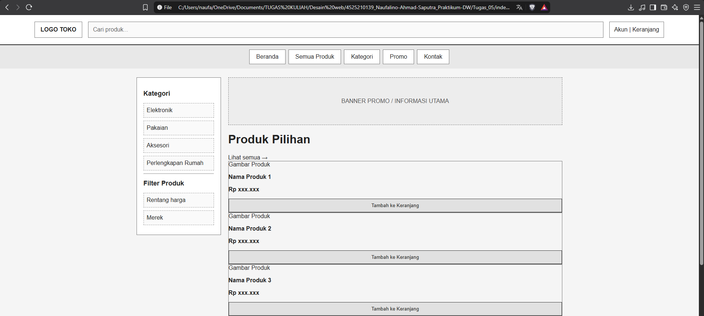
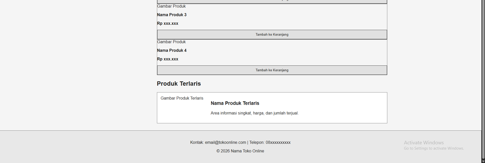

# Tugas 05 Wireframe dan Struktur Informasi

## Identitas Mahasiswa
| Informasi Praktikan | Keterangan |
| :--- | :---: |
| Nama |Naufalino Ahmad saputra |
| NPM  |4525210139 |
|Kelas |A |
|Prak |Desain Web | 
|Pertemuan |05 - Wireframe dan Struktur Informasi |

## Penjelasan
Template wireframe toko online ini dibuat untuk menggambarkan rancangan awal sebuah website toko online sebelum masuk ke tahap desain visual dan pengembangan fitur. Wireframe berfungsi sebagai kerangka halaman yang menunjukkan posisi elemen, susunan informasi, dan navigasi website.

Website ini terdiri dari beberapa bagian utama:
<li> Header: Menampilkan logo toko, kolom pencarian produk, akun pengguna, dan keranjang belanja.

<li> Navbar: Menyediakan menu navigasi seperti Beranda, Semua Produk, Kategori, Promo, dan Kontak.

<li> Sidebar: Menampilkan kategori produk dan filter untuk membantu pengguna menemukan produk.

<li> Banner: Menyediakan tempat untuk menampilkan promosi atau informasi utama toko.

<li> Daftar Produk: Menampilkan kartu produk yang berisi gambar, nama produk, harga, dan tombol tambah ke keranjang.

<li> Produk Terlaris: Menampilkan area khusus untuk produk yang paling banyak diminati.

<li> Footer: Berisi informasi kontak toko dan hak cipta.

 

Template ini dibuat menggunakan HTML untuk menyusun struktur halaman dan CSS untuk mengatur tata letak. CSS Grid, Flexbox, dan media query digunakan agar tampilan dapat menyesuaikan ukuran layar desktop maupun mobile.

## HASIL

## Kesimpulan
Pembuatan wireframe toko online membantu memahami proses perancangan website sebelum tahap implementasi. Dengan adanya wireframe, posisi elemen, susunan informasi, dan navigasi dapat direncanakan dengan lebih jelas. Tampilan responsif juga memungkinkan struktur halaman menyesuaikan ukuran layar perangkat yang digunakan. Template ini dapat dikembangkan lebih lanjut menjadi website toko online dengan desain visual, fitur pencarian, keranjang belanja, dan sistem transaksi yang berfungsi secara nyata.
