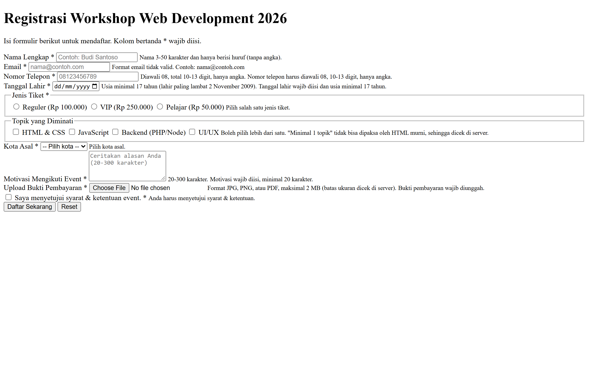
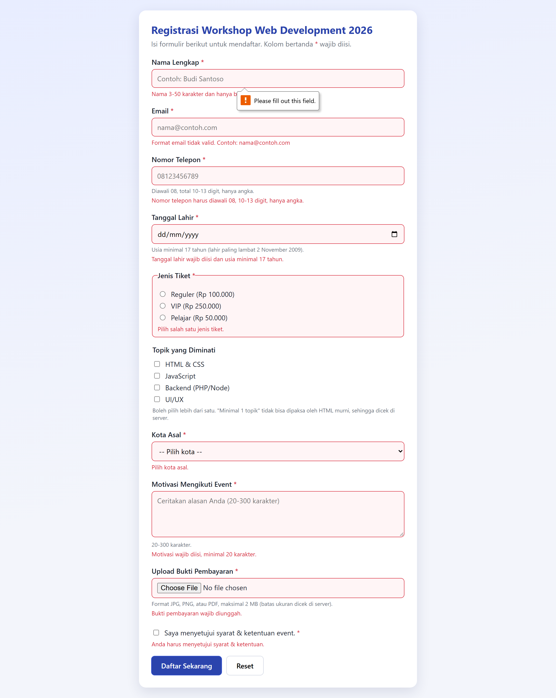

# Tugas 07 HTML FORM DASAR INPUT DAN PENGIRIMAN DATA

## Identitas Mahasiswa
| Informasi Praktikan | Keterangan |
| :--- | :---: |
| Nama |Naufalino Ahmad saputra |
| NPM  |4525210139 |
|Kelas |A |
|Prak |Desain Web | 
|Pertemuan |07 - HTML FORM DASAR INPUT DAN PENGIRIMAN DATA |

## Output Sebelum

## Output sesudah

### Masalah 1: Format Isian Telepon Tidak Sesuai Standar
- **Deskripsi:** Pengguna sering memasukkan nomor telepon dengan jumlah digit acak, berisi huruf, atau tidak diawali kode Indonesia.
- **Solusi:** Menggunakan atribut `pattern="08[0-9]{8,11}"` agar nomor selalu diawali 08 dan berjumlah 10–13 digit angka, serta `inputmode="numeric"` agar keyboard HP menampilkan angka.

### Masalah 2: Isian Nama Berisi Angka atau Terlalu Pendek
- **Deskripsi:** Kolom teks biasa menerima apa saja, termasuk angka dan simbol, misalnya "Budi123".
- **Solusi:** Menambahkan `minlength="3"`, `maxlength="50"`, dan `pattern` yang hanya mengizinkan huruf, spasi, titik, apostrof, dan tanda hubung.

### Masalah 3: Validasi Email Bawaan Terlalu Longgar
- **Deskripsi:** `type="email"` bawaan browser menerima alamat tanpa akhiran domain, seperti `budi@localhost`.
- **Solusi:** Menambahkan `pattern` yang mewajibkan domain dan akhiran minimal 2 huruf.

### Masalah 4: Peserta di Bawah Usia Minimal
- **Deskripsi:** HTML tidak bisa menghitung usia, padahal peserta wajib berusia minimal 17 tahun.
- **Solusi:** Memberi atribut `max="2009-11-02"` pada input tanggal lahir sebagai batas tanggal paling akhir. Karena nilainya tetap, di aplikasi nyata batas ini harus dihitung ulang oleh server.

### Masalah 5: Pilihan Radio, Checkbox, dan Select Dibiarkan Kosong
- **Deskripsi:** Pengguna bisa melewati pilihan tiket, kota, dan persetujuan syarat & ketentuan.
- **Solusi:** Memberi atribut `required` pada radio tiket, select kota (dengan opsi pertama bernilai kosong), dan checkbox persetujuan. Radio dan checkbox dibungkus `fieldset` agar seluruh grup bisa diberi garis merah dengan `:has(:user-invalid)`.

